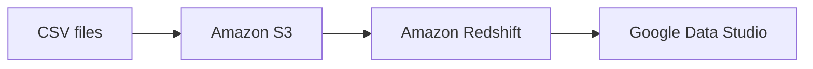

# AWS Redshift Data Warehouse

## Overview

This repository documents a hands-on data warehouse exercise completed as part of a Udemy data engineering course. The project uses sales data stored in CSV files, loads it from Amazon S3 into Amazon Redshift, and uses Google Data Studio to build a dashboard for analysis.

## Architecture



## Data Model

The warehouse schema models a sales scenario with the following tables:

- `Vendedores`: sales representatives.
- `Produtos`: product catalog and prices.
- `Clientes`: customer details.
- `Vendas`: sales transactions, linked to customers and sales representatives.
- `ItensVenda`: line items for each sale, including product, quantity, value, and discount information.

The table definitions, primary keys, and relationships are available in [sql/1.CreateTables.sql](sql/1.CreateTables.sql).

## Workflow

1. Create the data warehouse tables in Amazon Redshift using SQL.
2. Store the source CSV files in an Amazon S3 bucket.
3. Load the CSV data from S3 into the corresponding Redshift tables.
4. Connect Google Data Studio to the warehouse and build a dashboard for data exploration.

## Repository Structure

```text
.
├── sql/
│   └── 1.CreateTables.sql
└── tables/
    ├── clientes.csv
    ├── itensvenda.csv
    ├── produtos.csv
    ├── vendedores.csv
    └── vendas.csv
```

- [Table creation script](sql/1.CreateTables.sql)
- Source data: [clientes.csv](tables/clientes.csv), [itensvenda.csv](tables/itensvenda.csv), [produtos.csv](tables/produtos.csv), [vendedores.csv](tables/vendedores.csv), and [vendas.csv](tables/vendas.csv)

## Skills Demonstrated

- Data warehousing concepts
- Amazon Redshift
- Amazon S3
- SQL table design and relationships
- CSV data ingestion
- Google Data Studio dashboard development

## Notes

This is an educational portfolio project. It demonstrates the end-to-end flow from raw CSV files in Amazon S3 to a Redshift data warehouse and a Google Data Studio dashboard.
