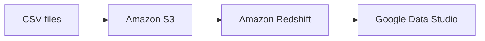

# Redshift Portfolio README Implementation Plan

> **For agentic workers:** REQUIRED SUB-SKILL: Use superpowers:subagent-driven-development (recommended) or superpowers:executing-plans to implement this plan task-by-task. Steps use checkbox (`- [ ]`) syntax for tracking.

**Goal:** Create an English, recruiter-oriented README that accurately documents the Redshift warehouse course project.

**Architecture:** A single repository-root `README.md` will document the project using GitHub-rendered Markdown. An embedded Mermaid flowchart depicts the documented path from CSV files through Amazon S3 and Amazon Redshift to Google Data Studio; relative links connect readers to source files already in the repository.

**Tech Stack:** Markdown, Mermaid, SQL, CSV, Amazon S3, Amazon Redshift, Google Data Studio.

**Spec:** `docs/superpowers/specs/2026-11-04-redshift-portfolio-readme-design.md`

## Global Constraints

- Write the README entirely in English.
- Identify the work as a hands-on Udemy course project.
- Do not invent row counts, data volumes, AWS configuration, ETL tooling, dashboard metrics, or automation.
- Do not modify existing SQL or CSV files.
- Use an embedded Mermaid diagram rather than a bitmap architecture image.
- Link only to existing repository files.

---

### Task 1: Create the portfolio README

**Files:**
- Create: `README.md`
- Inspect: `sql/1.CreateTables.sql`
- Inspect: `tables/clientes.csv`, `tables/itensvenda.csv`, `tables/produtos.csv`, `tables/vendas.csv`, `tables/vendedores.csv`

**Interfaces:**
- Consumes: the available table-creation SQL and CSV data files.
- Produces: a GitHub-rendered project overview with working relative links.

- [ ] **Step 1: Confirm repository facts used by the README**

Run:

```bash
rg -n "CREATE TABLE|references" sql/1.CreateTables.sql
rg --files tables sql
```

Expected: the SQL identifies five tables (`Vendedores`, `Produtos`, `Clientes`, `Vendas`, and `ItensVenda`) and the file listing identifies five CSV files plus `sql/1.CreateTables.sql`.

- [ ] **Step 2: Create `README.md`**

Include these exact sections: `# AWS Redshift Data Warehouse`, `## Overview`, `## Architecture`, `## Data Model`, `## Workflow`, `## Repository Structure`, `## Skills Demonstrated`, and `## Notes`.

Embed this data-flow diagram under `## Architecture`:



The overview states that the repository contains a hands-on Udemy course exercise. The data-model section names only the five tables present in the SQL. The repository-structure section links to `sql/1.CreateTables.sql` and each of the five files in `tables/`.

- [ ] **Step 3: Validate Markdown structure and links**

Run:

```bash
rg -n "^#{1,2} |```mermaid|\\]\\(" README.md
test -f sql/1.CreateTables.sql
test -f tables/clientes.csv
test -f tables/itensvenda.csv
test -f tables/produtos.csv
test -f tables/vendas.csv
test -f tables/vendedores.csv
```

Expected: every required heading and the Mermaid fence is present, and all six linked local targets exist.

- [ ] **Step 4: Review the final diff**

Run:

```bash
git diff --check
git diff -- README.md
```

Expected: no whitespace errors; the diff only adds the intended README documentation.

- [ ] **Step 5: Commit**

```bash
git add README.md
git commit -m "docs: add Redshift warehouse portfolio README"
```

Expected: the README becomes a standalone documentation commit. Only perform this step if the repository owner requests a commit.

## Self-Review

- Spec coverage: Task 1 covers the English project summary, Mermaid architecture, SQL-derived data model, documented workflow, repository links, skills, and scope boundaries.
- Placeholder scan: no unfinished implementation steps or undefined file targets remain.
- Type consistency: not applicable; this plan changes documentation only.
